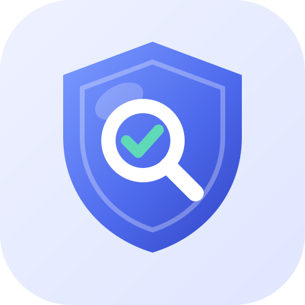

<p align="center"></p>

# Security Testing Toolkit

**Video walkthrough + full guide:** https://abhiramupadrashta.github.io/security-toolkit/

Part of [Bubbles Aro](https://abhiramupadrashta.github.io/) · free, open source, works with any language.

Automated security testing for any app (Node, Python, Java, Go, PHP, React, Flutter, and more).
It runs 4 free industry-standard scanners and gives you one combined report.

| # | Scanner | Finds |
|---|---|---|
| 1 | **Gitleaks** | API keys, passwords, tokens committed to git |
| 2 | **Semgrep** | Insecure code: SQL injection, XSS, weak crypto, etc. |
| 3 | **Trivy** | Vulnerable libraries + Dockerfile / Terraform / K8s misconfigs |
| 4 | **OWASP ZAP** | Live app issues: missing security headers, cookie flags, info leaks |

---

## Setup (2 minutes, one time)

Copy these into the **root of your project**:

```
.github/workflows/security-scan.yml
security/summarize.py
security/scan.sh
```

Add this line to your `.gitignore`:

```
security-reports/
```

Commit and push. That's it.

---

## Option A: Run on GitHub (few clicks, nothing to install)

1. Open your repo on GitHub, then the **Actions** tab
2. Click **Security Scan** in the left sidebar, then **Run workflow**
3. (Optional) paste your **staging URL** to also scan the live app
4. Click the green **Run workflow** button

When it finishes:
- The summary appears right on the run page
- Download **security-reports** at the bottom, then open `report.html` for the full filterable report

It also runs **automatically** on every push to main, on every pull request, and every Monday morning.

**Optional settings** (Repo, then Settings, then Secrets and variables, then Actions, then **Variables** tab):

| Variable | Example | Purpose |
|---|---|---|
| `SECURITY_TARGET_URL` | `https://staging.myapp.com` | Scan the live app on every automatic run |
| `SECURITY_FAIL_ON` | `high` / `critical` / `medium` / `none` | Which severity fails the run (default `high`) |

**Block risky pull requests:** Settings, then Branches, then add a rule for `main`, then require the **security-scan** status check.

---

## Option B: Run on your computer (one command)

Needs **Docker Desktop** and **Python 3**.

```bash
chmod +x security/scan.sh      # first time only

./security/scan.sh                           # code + secrets + dependencies
./security/scan.sh http://localhost:3000     # + live scan of your running app
```

The report opens automatically from `security-reports/report.html`.

---

## Scan your whole company GitHub

```bash
gh auth login                          # once
./security/scan-org.sh your-company    # every repo -> org-reports/index.html
```

Windows: start Docker Desktop, then run the commands in **Git Bash**.

---

## Reading the results

| Severity | What to do |
|---|---|
| **Critical / High** | Fix before releasing |
| **Medium** | Fix this sprint |
| **Low / Info** | Review; fix if cheap |

Common fixes:
- **Secret found:** rotate the key immediately (it's compromised once in git history), then move it to env vars or a secrets manager.
- **Vulnerable dependency:** upgrade to the version shown in "How to fix".
- **Missing security header (ZAP):** add headers like `Content-Security-Policy`, `X-Frame-Options`, `Strict-Transport-Security` (e.g. `helmet` for Express, `django-csp` / `SecurityMiddleware` for Django).

**False positive?**
- Semgrep: add `# nosemgrep` on that line
- Gitleaks: add the finding's fingerprint to a `.gitleaksignore` file
- Trivy: add the CVE ID to a `.trivyignore` file

---

## Important

- Only run the live (ZAP) scan against apps **you own**, preferably **staging/local, not production**.
  The baseline scan is passive and safe, but always get permission.
- These tools don't catch business-logic bugs such as user A seeing user B's data.
  Test those manually or with your own automated tests.
